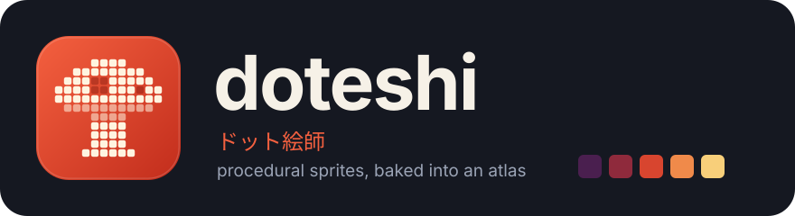
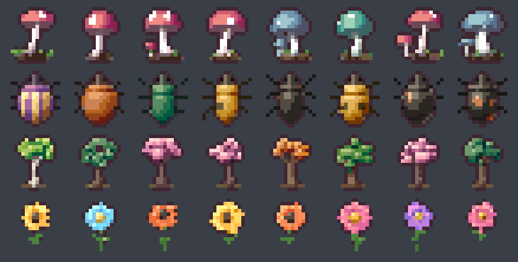
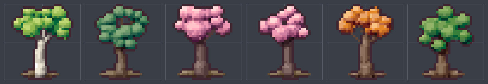
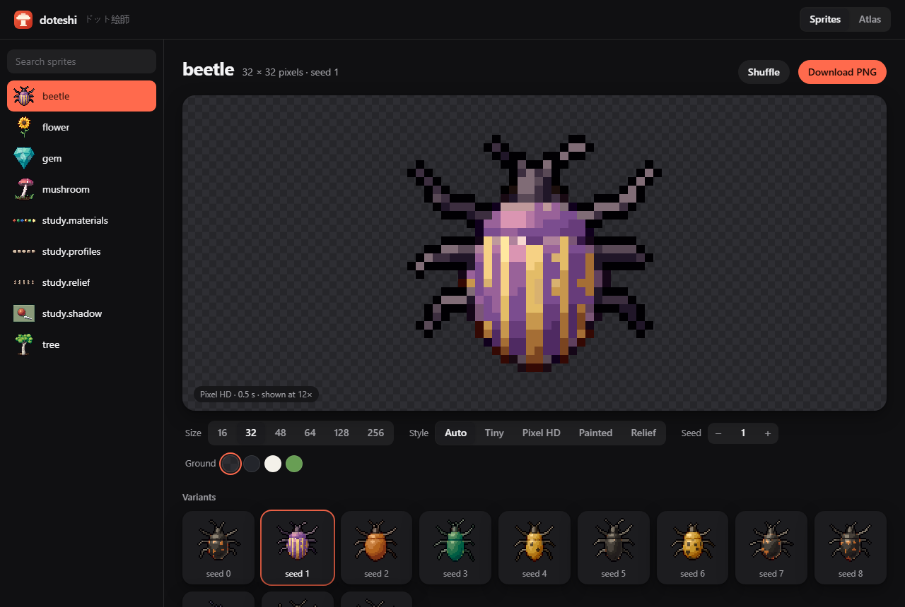
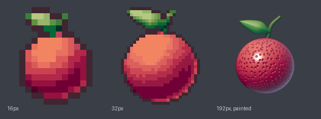

<p align="center"></p>

**doteshi** grows pixel-art sprites from code and bakes them into an atlas. You describe a sprite once, as parts with form and material; doteshi lights it, resolves it to hard pixels on a 16-pixel grid, and packs it beside the others. Every sprite is seeded, so one definition gives as many variants as you ask for.

It is being built for the game **Mellangan** and follows that game's conventions. The name is from ドット絵師 (*dotto eshi*), Japanese gaming slang for a pixel artist.

Twelve seeds each of five 16×16 sprites, shown six times enlarged:



Big structures are whole numbers of 16-pixel cells. These trees are 32×32, a 2×2 block of cells:



## Contents

- [Conventions](#conventions)
- [What it does](#what-it-does)
- [Quick start](#quick-start)
- [The web interface](#the-web-interface)
- [Writing a sprite](#writing-a-sprite)
- [How pixels are decided](#how-pixels-are-decided)
- [Baking an atlas](#baking-an-atlas)
- [Commands](#commands)
- [How it works](#how-it-works)
- [Project layout](#project-layout)
- [Status and limits](#status-and-limits)
- [Credits](#credits)

## Conventions

These come from Mellangan. The reference for the look is the first 11 rows of its atlas, the Kenney Tiny Dungeon and Tiny Town tiles.

1. **Living things face south.** Anything alive or animated is drawn facing the viewer, glancing a little to the south-south-east (down and slightly to the right on screen). The game moves it and mirrors it with a shader, so one drawing serves both directions. Mark such sprites `living=True`.
2. **Everything is 16×16.** A big structure may be 32×32, or larger, as long as each side is a multiple of 16. It is cut into 16×16 cells and stored as a block of them, so every piece is an ordinary cell to the game.
3. **One pixel scale.** A 32×32 structure is four cells of the same art, not a finer drawing. Everything up to 64 pixels uses the same style: hard pixels and a flat one-pixel outline in Mellangan's outline colour.
4. **A drawn look.** Shading moves through fine tone steps, the edges between tones waver slightly, and rough materials carry a few deliberate stray pixels. Glossy surfaces stay clean.

## What it does

- **Any kind.** A sprite is a scene of parts. The demo set has a slime, a beetle, a toadstool, a flower, a gem and a tree, and none of them needed a change to the engine.
- **Organic.** Trees are grown toward a cloud of points, seed heads are packed by the golden angle, outlines are warped by noise, and mirrored parts are never exact reflections.
- **Lit, not coloured in.** Each part has height. Light, cast shadow and occlusion are computed from that surface, and the result picks a tone from a hue-shifted ramp (shadows drift violet, lights drift warm).
- **Seeded.** The same sprite, seed and size always give the same pixels. Two bakes of the same manifest are byte-identical, and `doteshi verify` checks that.
- **A stable atlas.** A lock file records which cell every sprite sits in. Adding sprites never moves existing ones, so indices already used by the game stay valid.
- **Generated metadata.** The atlas image, a JSON description and a C++ header of named constants all come from the same lock file.
- **Scales up when asked.** The same definitions can be painted at any size for previews and promotional art:


## Quick start

You need [uv](https://docs.astral.sh/uv/) and Python 3.12 or newer. The only dependencies are numpy and Pillow.

```sh
uv sync                       # install
uv run doteshi serve --open   # open the web interface
uv run doteshi bake           # bake content/manifest.toml into out/
```

`bake` writes `out/atlas.png`, `out/atlas.json` and `out/atlas.gen.hpp`. This is the demo atlas, three times enlarged. It uses Mellangan's layout: 16-pixel sprites in 18-pixel cells, 24 columns, 432 pixels wide.


## The web interface

`uv run doteshi serve --open` starts a local server and opens the page. It listens on this machine only.



**Sprites** is for looking and choosing:

- Pick a sprite from the list on the left.
- Change its size, style and seed, or press Shuffle for a random seed. The preview always shows whole-number zoom, so pixels stay square.
- Try it on a transparent, dark, light or grass ground.
- Click a tile under Variants or Sizes to switch to it.
- Download the PNG, or copy the ready-made manifest entry under "Add to the atlas".

**Atlas** shows the last bake:

- Point at a sprite to see its name, position, size and cell number, and whether it is a living thing. Click it to open it under Sprites.
- Bake packs the manifest again and keeps every existing sprite in place. Repack discards saved placements and lays everything out from scratch.
- Download the image, the JSON and the header.

Sprite definitions are re-read whenever a file in the content folder changes. Edit a definition, switch back to the browser, and the page shows the new result. A file that fails to import is reported at the top of the page.

## Writing a sprite

A sprite is a Python function that adds parts to a scene. This one is in [examples/berry.py](examples/berry.py):

```python
from doteshi import mat, pat, sdf, sprite


@sprite("berry", sizes=[16], variants=8)
def berry(s, rng):
    colour = rng.choice(["#c0304a", "#3b4fb8", "#7a3fa0"])
    r = rng.uniform(0.5, 0.62)

    # A short stalk. It is a limb: at 16 pixels the fruit fills the cell and the stalk may run off it.
    s.part(sdf.stroke([(0.05, -0.35), (0.12, -0.62), (0.3, -0.8)], [0.05, 0.04, 0.03]),
           mat.matte("#5b7a35"), limb=True)

    # The fruit: a glossy ball with fine pores and a paler bloom toward the top.
    fruit = s.part(sdf.ellipse(r, r * 0.95, sphere=True).at(0.0, 0.2), mat.glossy(colour), z=0.02)
    fruit.bump(pat.pores(0.09, rng.seed32()), -0.015)
    fruit.tint("#f2d9e0", pat.gradient("y", 0.1, -0.4), 0.25)

    # A leaf with a raised midrib.
    leaf = s.part(sdf.leaf((0.1, -0.5), (-0.55, -0.72), 0.14), mat.satin("#4f8a3c", trans=0.4), z=0.05)
    leaf.bump(pat.custom(lambda c: 1.0 - abs(c.v) ** 0.5, size=0.04), 0.015)
```

```sh
uv run doteshi --content examples sheet berry --size 16 --scale 8
```



The pores are finer than a pixel at 16 and 32, so they are left out there and the form carries the sprite. They appear in the painted version.

### Sprite space

- The origin is the centre of the canvas. x runs right and y runs **down**. South is down.
- The canvas spans -1 to 1 top to bottom. Its width follows `aspect` (width over height) in `@sprite`; a 48×16 wall is `aspect=3.0` at size 16.
- Stand things on about y = 0.9.
- `z` lifts a part toward the viewer. Higher parts cover lower ones and cast shadows on them.

### Living things

Mark creatures `@sprite(..., living=True)` and draw them facing south with a glance to the south-south-east.

- **Seen from the front** (the slime): put the eyes right of centre and low on the body. See [content/demo/slime.py](content/demo/slime.py).
- **Seen from above** (the beetle): build it head-up, then call `s.turn(180 - 14)`. The whole scene turns; the light stays top left. See [content/demo/beetle.py](content/demo/beetle.py).

The flag is written to `atlas.json` and the header, so the game knows which sprites it may mirror.

### Shapes (`sdf`)

| Shape | What it is |
|---|---|
| `circle(r)`, `ellipse(rx, ry, sphere=False)` | Round bodies. `sphere=True` wraps patterns over the form. |
| `box(hw, hh, r)`, `polygon(points)` | Flat-sided shapes. |
| `capsule(a, b, ra, rb)` | A round-ended limb that can taper. |
| `stroke(points, radii)` | A tube along a curve, with a radius that varies along it. |
| `lathe(a, b, widths)` | A turned form seen from the side: an axis and a width profile. |
| `leaf(a, b, width)` | A pointed leaf or petal. |

Every shape can be placed and combined:

- **Place:** `.at(x, y)`, `.rot(degrees)`, `.mirror()`, `.scale(k)`.
- **Deform:** `.grow(amount)`, `.warp(amp, freq, seed)` for an uneven outline.
- **Combine:** `a | b` joins, `a - b` cuts, `a & b` keeps the overlap. `.union(b, k)` joins with a soft blend. `.above(y)` and `.below(y)` cut along a horizontal line.

### Profiles, materials and patterns

- **Profiles** (`profile`) say how a part rises from its edge: `dome` (the default), `flat()`, `bevel()`, `pillow()`, `ridge`, `dish()`.
- **Materials** (`mat`): `matte`, `satin`, `glossy`, `metal`, `translucent`, `glowing`. Each takes a colour and optional overrides: `rough`, `spec`, `metal`, `trans`, `irid`, `emit`. Roughness also decides how much deliberate imperfection a surface gets.
- **Patterns** (`pat`) are used two ways:
  - `part.bump(pattern, depth)` raises or sinks the surface, so light reacts to it.
  - `part.tint(colour, pattern, amount)` mixes a colour in where the pattern is strong.

| Kind | Patterns |
|---|---|
| Smooth | `mottle`, `lumps`, `gradient`, `edge`, `core` |
| Directional | `grain`, `ridges`, `rings`, `stripes` |
| Cellular | `spots`, `speckle`, `pores`, `cracks`, `facets`, `dimples`, `scales`, `scratches` |
| Your own | `custom(fn, size)` |

Patterns combine with `*`, `+` and `.step(lo, hi)`. Each has a feature size. A pattern too fine for the size being rendered is dropped, unless you mark it `.keep()`: then it is coarsened into fewer, larger features. Use `.keep()` for markings a sprite is recognised by, such as a toadstool's spots.

### Part options

| Option | Effect |
|---|---|
| `keep=True` | A key feature (an eye, a glint). It always gets one pixel, in exactly its own colour. |
| `limb=True` | An extremity (a leg, a feeler). The body is framed to fill the cell and limbs may run off it. |
| `soft=True` | Takes no outline (a shadow, a glow). |
| `min_size=32` | Left out below that sprite size. |
| `on=other` | Sits on another part and follows its surface. |
| `join=0.03` | Blends softly into what it touches. |

`s.pair(shape, material)` adds a part and its mirror image, with a slight nudge so the two sides differ.

### Growth and randomness

- `grow.branch.colonize(rng, root, targets)` grows a skeleton toward target points. `.radii()` thickens it and `.limbs()` returns limbs ready for `sdf.stroke`. See [content/demo/tree.py](content/demo/tree.py).
- `grow.phyllotaxis.spiral(n, radius)` places points by the golden angle. See [content/demo/flower.py](content/demo/flower.py).
- `rng` is seeded from the sprite id and seed. Use `rng.uniform`, `rng.int`, `rng.choice`, `rng.chance`, and `rng.stream("name")` for an independent stream that later edits will not disturb.

### Hand-drawn cells

Any size of any sprite can be replaced by a hand-drawn cell with `@override`. The demo gem does this at 16 pixels; see [content/demo/gem.py](content/demo/gem.py).

## How pixels are decided

A style profile turns a lit surface into pixels. By default it follows the size:

| Style | Default for | What it does |
|---|---|---|
| `tiny` | up to 64px | Hard pixels, a flat one-pixel outline, eight tone steps per colour, up to 18 colours in a 16×16 cell (more on larger blocks). Thin features are drawn as bare one-pixel lines. |
| `painted` | above 64px | Smooth edges, full detail, a soft tinted line round the silhouette. |
| `pixel-hd` | on request | Hard pixels with an outline tinted by each surface's own darkest tone. |
| `relief` | on request | Painted, with no outline. |

Set a style per sprite with `@sprite(..., style="pixel-hd")`, for a whole manifest or one entry with `style = "..."`, or try one with `--style`.

The pixel resolver works from a surface eight samples finer than the output and decides each pixel as a whole:

1. **Framing.** The sprite is fitted to the cell, less one pixel all round for the outline.
2. **Coverage.** A pixel is solid when half of it is covered. Features under a pixel wide get a one-pixel line along their ridge, so legs and stems never vanish.
3. **Ownership.** Each pixel belongs to the part covering most of it. Where a marking crosses a pixel, it takes one colour or the other, never a blend.
4. **Colour.** Base colours are grouped into a few families. Each gets a ramp of tones, and a pixel takes the tone nearest its lit colour. Highlights smaller than a pixel survive as one bright pixel.
5. **Separation.** Where one form passes behind another of the same colour, a darker line keeps them apart.
6. **Hand.** The edges between tones are nudged so they wander a little, and rough materials get a few pixels one tone off in their flat areas. Both are seeded, so they are the same on every bake.
7. **Cleanup.** One-pixel notches in the silhouette are filled and burrs shaved off.
8. **Outline.**

## Baking an atlas

A manifest lists what goes into the atlas. This is a shortened [content/manifest.toml](content/manifest.toml):

```toml
[atlas]
name = "atlas"            # output file stem
layout = "grid"           # "grid" (numbered cells) or "packed" (mixed sizes, trimmed)
cell = 16                 # sprite size
gutter = 1                # transparent border inside each 18-pixel cell
columns = 24
namespace = "atlas::gen"  # for the C++ header
content = "demo"          # folder of sprite definitions, relative to the manifest

[[sprite]]
id = "slime"
variants = 12             # seeds 0 to 11; or seeds = [3, 11]
pivot = "bottom"          # "bottom", "center", "top" or [x, y] as fractions

[[sprite]]                # a big structure: 32x32, stored as a 2x2 block of cells
id = "tree"
size = 32
variants = 12
pivot = "bottom"
```

Other keys: `style` (under `[atlas]` for every entry, or per entry), `sizes` (several sizes at once), and `tile = true` (repeat edge pixels into the gutter, for ground tiles that meet edge to edge).

**Layouts**

- **`grid`** is Mellangan's layout. Cells are numbered row by row and never renumbered. A sprite must be a whole number of cells each way; a larger one takes a rectangular block of cells, and the bake refuses any size that does not split cleanly.
- **`packed`** trims each sprite and packs mixed sizes tightly onto power-of-two pages (`padding`, `max_size`). It is there for other uses; Mellangan does not need it.

**The lock file** sits beside the manifest as `<name>.lock.json` and should be committed.

- Sprites already in it keep their cells. New sprites take the first free cells.
- A sprite removed from the manifest keeps its cells reserved, so putting it back does not move anything. `--prune` frees them.
- `--repack` discards the lock and lays everything out again.

**Outputs**

| File | Contents |
|---|---|
| `atlas.png` | The atlas image. |
| `atlas.json` | Grid settings and, for each sprite: `name`, `id`, `size`, `variant`, `x`, `y`, `w`, `h` (its first cell), `index`, `cols`, `rows`, `source` (full size), `pivot`, and `living` where it applies. |
| `atlas.gen.hpp` | One `inline constexpr Sprite` per sprite, named like `slime_16_3`, plus `CELL`, `PITCH`, `COLUMNS` and `piece()`. |

```cpp
#include "atlas.gen.hpp"
using namespace atlas::gen;

draw(slime_16_3, x, y, /* mirror: */ movingWest && slime_16_3.living);

for (int row = 0; row < tree_32_5.rows; ++row)          // a block of cells
    for (int col = 0; col < tree_32_5.cols; ++col)
        draw(piece(tree_32_5, row, col), x + col * CELL, y + row * CELL);
```

### Baking into Mellangan's bands

Mellangan addresses cells by band and index (its `tools/atlas_layout.py`), not by one grid. A band manifest places
each sprite there:

```toml
[atlas]
name = "doteshi"
layout = "mellangan"
bands = "../../atlas_layout.py"   # relative to the manifest
content = "content"

[[sprite]]
id = "oddity_geode"
band = "oddities b"
index = 0                         # optional: seed, size (a 32px sprite takes a 2x2 block), style
```

```sh
uv run python -m doteshi.atlas.mellangan bake path/to/manifest.toml --out out/mellangan [--check]
```

The bake writes `doteshi.png`, a page the size of the atlas with every sprite in its cell, and `doteshi.json`, and
updates `doteshi.lock.json` beside the manifest with a pixel hash per placement. It prints which sprites are new,
changed, moved or removed. `--check` leaves the lock alone and fails when it is stale. Mellangan's atlas build runs
this through its `tools/doteshi_assets.py`. `python -m doteshi.atlas.mellangan import --atlas ... --layout ...` pins
every existing cell and checks that the atlas rebuilds pixel for pixel.

## Commands

Run each as `uv run doteshi <command>`. `sprites` is a shorter alias for `doteshi`.

| Command | What it does |
|---|---|
| `serve [manifest]` | Open the web interface. `--open`, `--port`, `--host`. |
| `bake [manifest]` | Bake the atlas. `--out`, `--repack`, `--prune`, `--no-cache`. |
| `verify [manifest]` | Bake twice from scratch and compare every byte; check placements. |
| `list` | List registered sprites. |
| `render <id>` | Write single PNGs. `--size`, `--seeds`, `--style`. |
| `sheet <id>` | A sheet of seed variants. `--size`, `--seeds 1..16`, `--scale`. |
| `ladder <id>` | One sprite at a run of sizes. `--sizes 16,32,48,64`. |
| `debug <id>` | The surface and lighting layers: base colour, height, normals, occlusion, shadow. |
| `compare <id>` | Generated sprites in among reference sprites cut from a grid atlas, with measurements of both. |

`--content <folder>` before the command chooses where sprite definitions are loaded from (default `content`).

To see generated sprites among the reference tiles of Mellangan's atlas:

```sh
uv run doteshi compare slime beetle mushroom --reference path/to/mellangan/res/atlas.png --cells 168..172,192..196
```

Run the tests with `uv run pytest`. Regenerate the images in this README with `uv run python docs/make_images.py`.

## How it works

```
definition + seed ──> parts ──> surface ──> light ──> resolver ──> atlas
                      shape     coverage    key, fill  tiny        cells
                      profile   height      shadow     painted     lock
                      material  normal      occlusion              export
                      patterns  colour      highlight
```

1. **Parts.** The sprite function builds a scene. Each part is a shape as a distance field, a height profile, a material, and patterns for relief and colour.
2. **Surface.** The scene is sampled into a buffer of coverage, height, slope, base colour and surface properties. Parts are layered by height.
3. **Light.** A key light from the top left, a soft fill, a cool rim light, shadows cast across the height field, and occlusion in creases. The gathered light picks a tone from the material's ramp; highlights and glow are added on top.
4. **Resolver.** The style profile turns the lit surface into pixels.
5. **Atlas.** Sprites are cut into cells, placed without disturbing earlier placements, and written out with their metadata.

## Project layout

```
src/doteshi/
  core/      rng, noise, shapes (sdf), curves, colour, the surface buffer
  form/      parts, scenes, height profiles
  grow/      branching, spiral placement
  shade/     materials, patterns, lighting
  resolve/   style profiles, the pixel and painted resolvers
  atlas/     cells and packing, lock file, edge handling, export, bake
  lint/      measurements and review sheets
  web/       the web interface and its server
  cli.py     the command line
content/     the demo sprites and manifest
examples/    the sprite from this README
docs/        logo and README images
tests/       78 tests
TODO.md      the plan, with what is done and what is open
```

## Status and limits

doteshi is at version 0.1. The plan and its open items are in [TODO.md](TODO.md).

**Works today:** the renderer, both resolvers, six demo kinds, branching and spiral growth, the cell atlas with lock file and exports, the web interface, and 78 passing tests.

**Not built yet:**

- A generated replacement for Mellangan's hand-written atlas header.
- Animation frames (walk, idle, attack) for living things.
- A `lint` command with thresholds, and a look-alike check between sprites.
- More growth generators and a wider library of kinds. There is no humanoid yet.
- A licence has not been chosen.

**Known limits:**

- **Richer than the reference.** Generated 16×16 sprites average about 17 colours; the Kenney characters in Mellangan's atlas average about 7. That follows the request for more detail and finer transitions, and it means generated sprites look busier beside unmodified Kenney tiles. The `tiny` profile's `levels`, `colors`, `waver` and `flecks` settings turn it down.
- **Faces are hard.** Objects, plants and simple creatures read well at 16 pixels. Characters with faces are better hand-drawn, which is what `@override` is for.
- **Speed.** A 16×16 sprite takes 0.04 to 0.4 seconds. A cold bake of the 72-sprite demo atlas takes about 13 seconds; a bake with nothing changed takes under a second. Any code change re-renders everything.
- **Determinism** is promised on one machine with the same `uv.lock`. Identical output across operating systems has not been checked.
- **The web interface** was checked in a Chromium browser in dark mode. Light mode and other browsers are untested.
- Sprites are drawn for one view. Other facings come from the game's mirroring, not from doteshi.

## Credits

- The design grew out of the sprite scripts of Mellangan. Its colour ramps, its outline colour and its orphan-pixel measure are carried over.
- The reference palette that the `tiny` style snaps onto comes from Kenney's Tiny Town and Tiny Dungeon packs, which are CC0.
