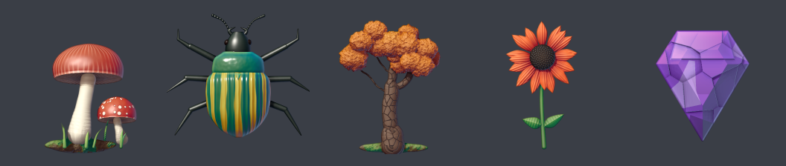
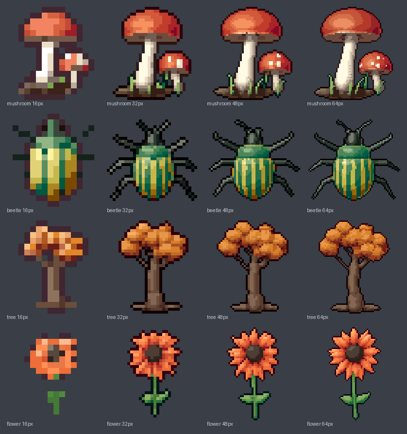
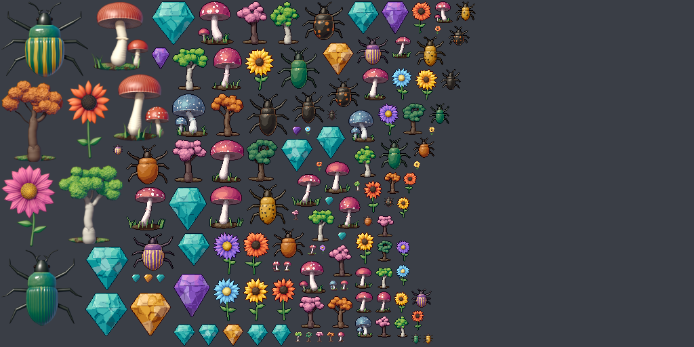

<p align="center"></p>

**doteshi** grows sprites from code and bakes them into an atlas. You describe a sprite once, as parts with form and material, and doteshi renders it at any size: crisp pixel art at 16 to 64 pixels, smooth painted art above that. Every sprite is seeded, so one definition gives as many variants as you ask for.

The name is from ドット絵師 (*dotto eshi*), Japanese gaming slang for a pixel artist.



The same definitions at 16, 32, 48 and 64 pixels. Each size is resolved on its own, not scaled from another:



## Contents

- [What it does](#what-it-does)
- [Quick start](#quick-start)
- [The web interface](#the-web-interface)
- [Writing a sprite](#writing-a-sprite)
- [Sizes and styles](#sizes-and-styles)
- [Baking an atlas](#baking-an-atlas)
- [Commands](#commands)
- [How it works](#how-it-works)
- [Project layout](#project-layout)
- [Status and limits](#status-and-limits)
- [Credits](#credits)

## What it does

- **Any size.** A sprite is described in its own units, not in pixels. At small sizes a dedicated pixel resolver decides every pixel as a whole; at large sizes a painted resolver keeps smooth edges and full detail.
- **Any kind.** A sprite is a scene of parts. The demo set has a toadstool, a beetle, a tree, a flower and a cut gem, and none of them needed a change to the engine.
- **Organic.** Trees are grown toward a cloud of points, seed heads are packed by the golden angle, outlines are warped by noise, and mirrored parts are never exact reflections.
- **Lit, not coloured in.** Each part has height. Light, cast shadow and occlusion are computed from that surface, and the result picks a tone from a hue-shifted ramp (shadows drift violet, lights drift warm).
- **Seeded.** The same sprite, seed and size always give the same pixels. Two bakes of the same manifest are byte-identical, and `doteshi verify` checks that.
- **A stable atlas.** A lock file records where every sprite sits. Adding sprites never moves existing ones, so coordinates already used by a game stay valid.
- **Generated metadata.** The atlas image, a JSON description and a C++ header of named constants all come from the same lock file.

## Quick start

You need [uv](https://docs.astral.sh/uv/) and Python 3.12 or newer. The only dependencies are numpy and Pillow.

```sh
uv sync                       # install
uv run doteshi serve --open   # open the web interface
uv run doteshi bake           # bake content/manifest.toml into out/
```

`bake` writes `out/atlas.png`, `out/atlas.json` and `out/atlas.gen.hpp`. This is the demo atlas:



## The web interface

`uv run doteshi serve --open` starts a local server and opens the page. It listens on this machine only.


**Sprites** is for looking and choosing:

- Pick a sprite from the list on the left.
- Change its size, style and seed, or press Shuffle for a random seed. The preview always shows whole-number zoom, so pixels stay square.
- Try it on a transparent, dark, light or grass ground.
- Click a tile under Variants or Sizes to switch to it.
- Download the PNG, or copy the ready-made manifest entry under "Add to the atlas".

**Atlas** shows the last bake:

- Point at a sprite to see its name, position, size and pivot. Click it to open it under Sprites.
- Bake packs the manifest again and keeps every existing sprite in place. Repack discards saved placements and lays everything out from scratch.
- Download the image, the JSON and the header.

Sprite definitions are re-read whenever a file in the content folder changes. Edit a definition, switch back to the browser, and the page shows the new result. A file that fails to import is reported at the top of the page.

## Writing a sprite

A sprite is a Python function that adds parts to a scene. This one is in [examples/berry.py](examples/berry.py):

```python
from doteshi import mat, pat, sdf, sprite


@sprite("berry", sizes=[16, 32, 64], variants=8)
def berry(s, rng):
    colour = rng.choice(["#c0304a", "#3b4fb8", "#7a3fa0"])
    r = rng.uniform(0.5, 0.62)

    # A short stalk. It is a limb: at 16 pixels the fruit fills the cell and the stalk may run off it.
    s.part(sdf.stroke([(0.05, -0.35), (0.12, -0.62), (0.3, -0.8)], [0.05, 0.04, 0.03]),
           mat.matte("#5b7a35"), limb=True)

    # The fruit: a glossy ball with fine pores and a paler bloom toward the top.
    fruit = s.part(sdf.ellipse(r, r * 0.95, sphere=True).at(0.0, 0.2), mat.glossy(colour), z=0.02)
    fruit.bump(pat.pores(0.09, rng.seed32()), -0.015)
    fruit.tint("#f2d9e0", pat.gradient("y", 0.1, -0.4), 0.25)

    # A leaf with a raised midrib.
    leaf = s.part(sdf.leaf((0.1, -0.5), (-0.55, -0.72), 0.14), mat.satin("#4f8a3c", trans=0.4), z=0.05)
    leaf.bump(pat.custom(lambda c: 1.0 - abs(c.v) ** 0.5, size=0.04), 0.015)
```

```sh
uv run doteshi --content examples ladder berry --sizes 16,32,64,192
```


At 192 pixels the pores are drawn. At 64 and below they would be finer than a pixel, so they are left out and the form carries the sprite.

### Sprite space

- The origin is the centre of the canvas. x runs right and y runs **down**.
- The canvas spans -1 to 1 top to bottom. Its width follows `aspect` (width over height) in `@sprite`.
- Stand things on about y = 0.9.
- `z` lifts a part toward the viewer. Higher parts cover lower ones and cast shadows on them.

### Shapes (`sdf`)

| Shape | What it is |
|---|---|
| `circle(r)`, `ellipse(rx, ry, sphere=False)` | Round bodies. `sphere=True` wraps patterns over the form. |
| `box(hw, hh, r)`, `polygon(points)` | Flat-sided shapes. |
| `capsule(a, b, ra, rb)` | A round-ended limb that can taper. |
| `stroke(points, radii)` | A tube along a curve, with a radius that varies along it. |
| `lathe(a, b, widths)` | A turned form seen from the side: an axis and a width profile. |
| `leaf(a, b, width)` | A pointed leaf or petal. |

Every shape can be placed and combined:

- **Place:** `.at(x, y)`, `.rot(degrees)`, `.mirror()`, `.scale(k)`.
- **Deform:** `.grow(amount)`, `.warp(amp, freq, seed)` for an uneven outline.
- **Combine:** `a | b` joins, `a - b` cuts, `a & b` keeps the overlap. `.union(b, k)` joins with a soft blend. `.above(y)` and `.below(y)` cut along a horizontal line.

### Profiles, materials and patterns

- **Profiles** (`profile`) say how a part rises from its edge: `dome` (the default), `flat()`, `bevel()`, `pillow()`, `ridge`, `dish()`.
- **Materials** (`mat`): `matte`, `satin`, `glossy`, `metal`, `translucent`, `glowing`. Each takes a colour and optional overrides: `rough`, `spec`, `metal`, `trans`, `irid`, `emit`.
- **Patterns** (`pat`) are used two ways:
  - `part.bump(pattern, depth)` raises or sinks the surface, so light reacts to it.
  - `part.tint(colour, pattern, amount)` mixes a colour in where the pattern is strong.

| Kind | Patterns |
|---|---|
| Smooth | `mottle`, `lumps`, `gradient`, `edge`, `core` |
| Directional | `grain`, `ridges`, `rings`, `stripes` |
| Cellular | `spots`, `speckle`, `pores`, `cracks`, `facets`, `dimples`, `scales`, `scratches` |
| Your own | `custom(fn, size)` |

Patterns combine with `*`, `+` and `.step(lo, hi)`. Each has a feature size. A pattern too fine for the size being rendered is dropped, unless you mark it `.keep()`: then it is coarsened into fewer, larger features. Use `.keep()` for markings a sprite is recognised by, such as a toadstool's spots.

### Part options

| Option | Effect |
|---|---|
| `keep=True` | A key feature (an eye, a glint). At small sizes it always gets one pixel, in its own colour. |
| `limb=True` | An extremity (a leg, a feeler). At 16 pixels the body fills the cell and limbs may run off it. |
| `soft=True` | Takes no outline (a shadow, a glow). |
| `min_size=32` | Left out below that sprite size. |
| `on=other` | Sits on another part and follows its surface. |
| `join=0.03` | Blends softly into what it touches. |

`s.pair(shape, material)` adds a part and its mirror image, with a slight nudge so the two sides differ.

### Growth and randomness

- `grow.branch.colonize(rng, root, targets)` grows a skeleton toward target points. `.radii()` thickens it and `.limbs()` returns limbs ready for `sdf.stroke`. See [content/demo/tree.py](content/demo/tree.py).
- `grow.phyllotaxis.spiral(n, radius)` places points by the golden angle. See [content/demo/flower.py](content/demo/flower.py).
- `rng` is seeded from the sprite id and seed. Use `rng.uniform`, `rng.int`, `rng.choice`, `rng.chance`, and `rng.stream("name")` for an independent stream that later edits will not disturb.

## Sizes and styles

A style profile decides how a lit surface becomes pixels. By default it follows the size:

| Style | Default for | What it does |
|---|---|---|
| `tiny` | up to 24px | Hard pixels, up to 12 colours, a flat one-pixel outline. Thin features are drawn as bare one-pixel lines. The sprite's body is framed to fill the cell. |
| `pixel-hd` | 25 to 64px | Hard pixels, up to 24 colours, an outline tinted by each surface's own darkest tone. The whole sprite is framed to fill the cell. |
| `painted` | above 64px | Smooth edges, full detail, a soft tinted line round the silhouette. |
| `relief` | on request | Painted, with no outline. |

Set a style per sprite with `@sprite(..., style="pixel-hd")`, per manifest entry with `style = "tiny"`, or try one with `--style`.

Here are eight seeds of four sprites at 16 pixels, shown six times enlarged:


The pixel resolver works from a surface eight samples finer than the output and decides each pixel as a whole:

1. **Coverage.** A pixel is solid when half of it is covered. Features under a pixel wide get a one-pixel line along their ridge, so legs and stems never vanish.
2. **Ownership.** Each pixel belongs to the part covering most of it. Where a marking crosses a pixel, it takes one colour or the other, never a blend.
3. **Colour.** Base colours are grouped into a few families. Each gets a ramp of tones, and a pixel takes the tone nearest its lit colour. Light and shade are exaggerated a little, and highlights smaller than a pixel survive as one bright pixel.
4. **Separation.** Where one form passes behind another of the same colour, a darker line keeps them apart.
5. **Cleanup.** Stray single pixels are absorbed, one-pixel notches are filled and burrs shaved off.
6. **Outline.**

**Hand-drawn cells.** Any size of any sprite can be replaced by a hand-drawn cell with `@override`. The demo gem does this at 16 pixels; see [content/demo/gem.py](content/demo/gem.py).

## Baking an atlas

A manifest lists what goes into the atlas. This is a shortened [content/manifest.toml](content/manifest.toml):

```toml
[atlas]
name = "atlas"            # output file stem
layout = "packed"         # "packed" (mixed sizes, trimmed) or "grid" (uniform cells, numbered)
padding = 2               # transparent gap round every sprite
max_size = 2048           # largest page edge before a second page is started
namespace = "atlas::gen"  # for the C++ header
content = "demo"          # folder of sprite definitions, relative to the manifest

[[sprite]]
id = "mushroom"
sizes = [16, 32, 48, 64]
variants = 6              # seeds 0 to 5; or seeds = [3, 11]
pivot = "bottom"          # "bottom", "center", "top" or [x, y] as fractions
```

Other `[[sprite]]` keys: `size` (one size), `style`, and `tile = true` (repeat edge pixels into the padding, for tiles that meet edge to edge).

**Layouts**

- **`packed`** trims each sprite to its visible pixels and packs mixed sizes tightly onto power-of-two pages. Transparent pixels round each sprite carry its edge colour, so filtered sampling shows no dark halo.
- **`grid`** places equal-sized sprites in numbered cells (`cell`, `gutter`, `columns`). Indices are append-only. The defaults match a 16-pixel sprite in an 18-pixel cell, 24 columns wide.

**The lock file** sits beside the manifest as `<name>.lock.json` and should be committed.

- Sprites already in it keep their place. New sprites take free space.
- A sprite removed from the manifest keeps its slot reserved, so putting it back does not move anything. `--prune` frees those slots.
- `--repack` discards the lock and lays everything out again.

**Outputs**

| File | Contents |
|---|---|
| `atlas.png` | The page image (further pages are `atlas_1.png`, and so on). |
| `atlas.json` | Pages and, for each sprite: `name`, `id`, `size`, `variant`, `page`, `x`, `y`, `w`, `h`, `source` (untrimmed size), `trim` (offset inside it), `pivot`, and `index` for grids. |
| `atlas.gen.hpp` | One `inline constexpr Sprite` per sprite, named like `mushroom_32_3`. |

```cpp
#include "atlas.gen.hpp"

const atlas::gen::Sprite& s = atlas::gen::mushroom_32_3;
draw(page[s.page], s.x, s.y, s.w, s.h, x - s.px, y - s.py);   // px, py is the pivot
```

## Commands

Run each as `uv run doteshi <command>`. `sprites` is a shorter alias for `doteshi`.

| Command | What it does |
|---|---|
| `serve [manifest]` | Open the web interface. `--open`, `--port`, `--host`. |
| `bake [manifest]` | Bake the atlas. `--out`, `--repack`, `--prune`, `--no-cache`. |
| `verify [manifest]` | Bake twice from scratch and compare every byte; check placements. |
| `list` | List registered sprites. |
| `render <id>` | Write single PNGs. `--size`, `--seeds`, `--style`. |
| `sheet <id>` | A sheet of seed variants. `--size`, `--seeds 1..16`, `--scale`. |
| `ladder <id>` | One sprite at a run of sizes. `--sizes 16,32,48,64`. |
| `debug <id>` | The surface and lighting layers: base colour, height, normals, occlusion, shadow. |
| `compare <id>` | Generated sprites in among reference sprites cut from a grid atlas, with measurements of both. |

`--content <folder>` before the command chooses where sprite definitions are loaded from (default `content`).

Run the tests with `uv run pytest`. Regenerate the images in this README with `uv run python docs/make_images.py`.

## How it works

```
definition + seed ──> parts ──> surface ──> light ──> resolver ──> atlas
                      shape     coverage    key, fill  tiny        pack
                      profile   height      shadow     pixel-hd    lock
                      material  normal      occlusion  painted     export
                      patterns  colour      highlight
```

1. **Parts.** The sprite function builds a scene. Each part is a shape as a distance field, a height profile, a material, and patterns for relief and colour.
2. **Surface.** The scene is sampled into a buffer of coverage, height, slope, base colour and surface properties. Parts are layered by height.
3. **Light.** A key light from the top left, a soft fill, a cool rim light, shadows cast across the height field, and occlusion in creases. The gathered light picks a tone from the material's ramp; highlights and glow are added on top.
4. **Resolver.** The style profile turns the lit surface into pixels.
5. **Atlas.** Sprites are trimmed, placed without disturbing earlier placements, and written out with their metadata.

## Project layout

```
src/doteshi/
  core/      rng, noise, shapes (sdf), curves, colour, the surface buffer
  form/      parts, scenes, height profiles
  grow/      branching, spiral placement
  shade/     materials, patterns, lighting
  resolve/   style profiles, the pixel and painted resolvers
  atlas/     packing, lock file, edge handling, export, bake
  lint/      measurements and review sheets
  web/       the web interface and its server
  cli.py     the command line
content/     the demo sprites and manifest
examples/    the sprite from this README
docs/        logo and README images
tests/       69 tests
TODO.md      the plan, with what is done and what is open
```

## Status and limits

doteshi is at version 0.1. The plan and its open items are in [TODO.md](TODO.md).

**Works today:** the renderer, both resolvers, five demo kinds, branching and spiral growth, the atlas baker with lock file and exports, the web interface, and 69 passing tests.

**Not built yet:**

- A `lint` command with thresholds, and a look-alike check between sprites.
- Importing existing sheets into an atlas, and companion normal or glow atlases.
- Rigs and animation frames.
- More growth generators (cell patterns, markings, fur strokes) and a wider library of kinds.
- A licence has not been chosen.

**Known limits:**

- **16 pixels is hard.** Generated 16-pixel sprites read well for objects, plants and simple creatures. Characters with faces are better hand-drawn, which is what `@override` is for.
- **Speed.** Measured on the development machine: a 16-pixel sprite takes 0.1 to 0.4 seconds, a 64-pixel tree 3.3 seconds, a 256-pixel tree 5.8 seconds. A cold bake of the 128-sprite demo atlas took between 80 and 200 seconds across runs; a bake with nothing changed takes under a second. Any code change re-renders everything.
- **Determinism** is promised on one machine with the same `uv.lock`. Identical output across operating systems has not been checked.
- **The web interface** was checked in a Chromium browser in dark mode. Light mode and other browsers are untested.
- Sprites are drawn for one view. There is no rotation to other angles.

## Credits

- The design grew out of the sprite scripts of the game Mellangan. Its colour ramps, its outline colour and its orphan-pixel measure are carried over.
- The reference palette that the `tiny` style snaps onto comes from Kenney's Tiny Town and Tiny Dungeon packs, which are CC0.
